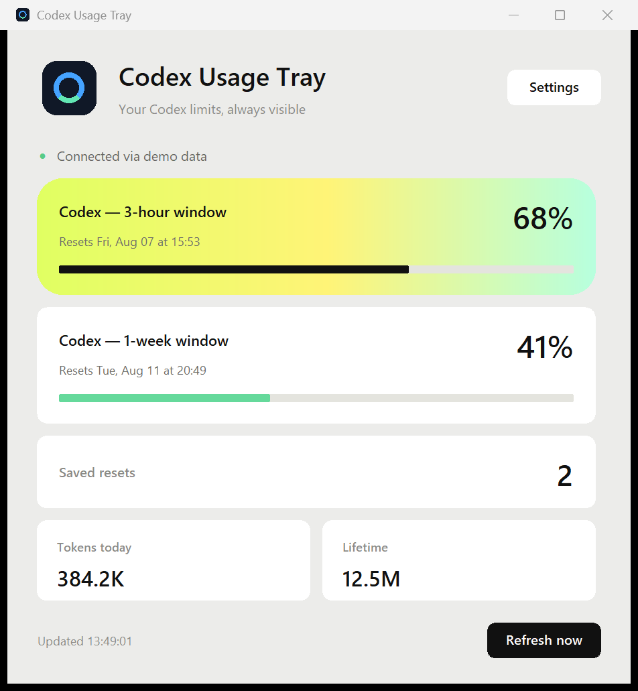
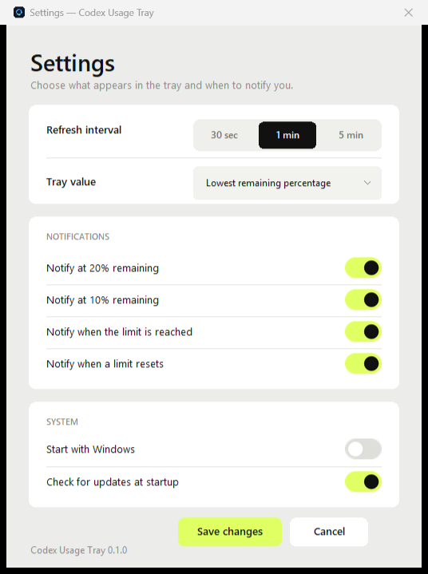

# Codex Usage Tray

Codex Usage Tray — privacy-first приложение для Windows, которое показывает в системном трее остаток лимитов OpenAI Codex, время сброса и количество сохранённых сбросов.





Приложение не предполагает существование фиксированного пятичасового лимита: оно показывает динамические окна, которые возвращает локальный официальный Codex App Server.

## Главное

- крупные прозрачные цифры в трее без кружка;
- все окна лимитов и время их сброса;
- просмотр сохранённых сбросов без возможности их применить;
- без чтения файлов с токенами и без телеметрии;
- права администратора не нужны;
- автозапуск только по явному включению через пользовательский HKCU;
- необязательная проверка обновлений, без автоматического скачивания.

## Запуск из исходников

Нужны Python 3.14 и `uv`:

```powershell
uv sync --frozen
uv run python -m codex_usage_tray
```

Демонстрационный режим не запускает Codex и не использует сеть:

```powershell
uv run python -m codex_usage_tray --demo
```

Готовую portable-версию можно скачать на странице [Releases](https://github.com/alex-indi/codex-usage-tray/releases).

Первая версия поддерживает только Windows 10/11 x64. Интерфейс приложения английский. Подробности о данных и безопасности: [PRIVACY.md](PRIVACY.md) и [SECURITY.md](SECURITY.md).
